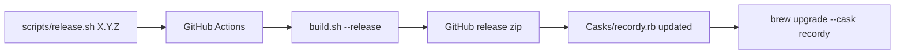

# Recordy

A native macOS screen recorder with a camera overlay, cursor zooms and a built-in editor. Record, polish and export in one app, without a cloud account.

## Features

- **Screen capture**: a full display or a selected area, at 30 or 60 fps (ScreenCaptureKit)
- **Camera overlay**: circle, rounded square, rectangle or portrait shapes in any corner, with mirroring and background blur
- **Audio**: microphone and system audio, plus music tracks and voice-overs added in the editor
- **Zoom**: zoom in on the cursor while recording or add zoom steps afterwards, optionally following the cursor
- **Editor**: timeline with trim, camera changes over time, audio split and volume, undo/redo
- **Styling**: wallpapers, gradients, patterns or your own image as the background, with aspect presets (16:9, 4:3, 1:1, 9:16)
- **Export**: MP4 or MOV at native resolution, 720p, 1080p, 1440p or 4K
- **Menu bar**: start and stop recording from the menu bar, with global hotkeys
- **Themes**: System, Signal, Midnight, Tiles and Planet

Recordings are saved to `~/Movies/Recordy`.

## Requirements

- macOS 14 Sonoma or later
- Apple silicon or Intel

## Install

### Homebrew

```sh
brew tap funivan/recordy https://github.com/funivan/recordy
brew install --cask funivan/recordy/recordy
```

Update with `brew upgrade --cask recordy`.

### Manual

Download `Recordy-<version>.zip` from [Releases](https://github.com/funivan/recordy/releases), unzip it and move `Recordy.app` to `/Applications`.

The app is not notarized, so on first launch macOS may block it. Clear the quarantine flag once:

```sh
xattr -dr com.apple.quarantine /Applications/Recordy.app
```

### Permissions

On first use macOS asks for:

- **Screen Recording**: required to capture the screen
- **Camera** and **Microphone**: only when you enable them

Grant them in **System Settings → Privacy & Security**, then restart Recordy.

## Hotkeys

Global hotkeys use `⌃⌥⌘` plus a key:

- `⌃⌥⌘R`: start / stop recording
- `⌃⌥⌘E`: stop recording and open in the editor
- `⌃⌥⌘I`: zoom in on the cursor
- `⌃⌥⌘O`: zoom out
- `⌃⌥⌘M`: move the camera to the next corner
- `⌃⌥⌘N`: change the camera shape
- `⌃⌥⌘H`: show / hide the camera

In the editor:

- `Space`: play / pause
- `⌘Z` / `⇧⌘Z`: undo / redo
- `⌘E`: export
- `⌥⌘I`: toggle the inspector
- `⌘[`: back to recordings

## Build from source

Requires Xcode command line tools with Swift 5.9 or later.

```sh
git clone git@github.com:funivan/recordy.git
cd recordy
./build.sh          # build Recordy.app for the host architecture
./build.sh --full   # build, quit the running app and relaunch it
```

Local builds are signed with a `Recordy Local Signing` identity when one exists in the keychain, otherwise ad-hoc. A stable identity keeps macOS privacy permissions across rebuilds.

### Command line

```sh
Recordy.app/Contents/MacOS/Recordy --export <project-dir> <output.mp4>
```

Exports a saved project from `~/Movies/Recordy` without opening the UI.

## Releasing

```sh
./scripts/release.sh          # list released versions
./scripts/release.sh 1.0.0    # tag v1.0.0 and push it
```

The script requires a clean `main` that matches `origin/main`.

The [Release workflow](.github/workflows/release.yml) then:

1. Builds a universal (arm64 + x86_64) app with `./build.sh --release`
2. Publishes `Recordy-<version>.zip` as a GitHub release
3. Updates the version and checksum in [`Casks/recordy.rb`](Casks/recordy.rb) on `main`



For a signed and notarized build, run it locally with a Developer ID certificate:

```sh
NOTARY_PROFILE=<profile> VERSION=1.0.0 ./build.sh --release
```

## Project layout

- `Sources/Recordy`: SwiftUI app (capture, editor, renderer, exporter)
- `Resources`: app icon and bundled wallpapers
- `tools`: scripts that generate the icon and wallpapers
- `Casks`: Homebrew cask
- `build.sh`: builds, signs and packages the app
- `scripts/release.sh`: tags and pushes a release
