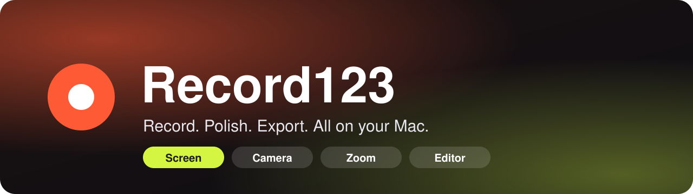
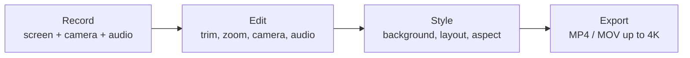
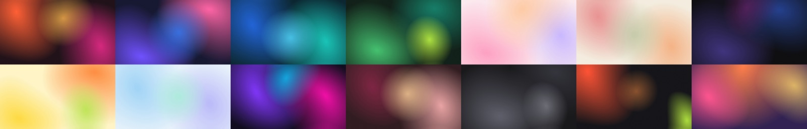

<div align="center">



<br>

[](https://github.com/funivan/record123/releases/latest)
[](https://github.com/funivan/record123/releases)
[](#requirements)
[](https://swift.org)
[](#homebrew)
[](https://github.com/funivan/record123/stargazers)

**A native macOS screen recorder with a camera overlay, cursor zooms and a built-in editor.**
<br>
Record, polish and export in one app. No cloud account, no subscription, no upload.

[Install](#install) · [Features](#features) · [Hotkeys](#hotkeys) · [Build](#build-from-source) · [Contributing](CONTRIBUTING.md) · [Releasing](docs/RELEASING.md)

</div>

---

## About

Record123 is for demos, tutorials, bug reports and product walkthroughs that should look good without a video editing session. It captures your screen with ScreenCaptureKit, lets you tweak everything afterwards in a timeline editor, and exports a clean MP4 or MOV. Everything stays on your machine.



## Features

- 🖥️ **Screen capture**: a full display or a selected area, at 30 or 60 fps
- 📷 **Camera overlay**: circle, rounded square, rectangle or portrait, in any corner, with mirroring and background blur
- 🎙️ **Audio**: microphone and system audio, plus music tracks and voice-overs added in the editor
- 🔍 **Cursor zoom**: zoom in while recording or add zoom steps afterwards, optionally following the cursor
- ✂️ **Editor**: timeline with trim, camera changes over time, audio split and volume, undo/redo
- 🎨 **Styling**: wallpapers, gradients, patterns or your own image, with aspect presets (16:9, 4:3, 1:1, 9:16)
- 📦 **Export**: MP4 or MOV at native resolution, 720p, 1080p, 1440p or 4K
- ⌨️ **Menu bar and hotkeys**: start and stop without leaving what you are doing
- 🌗 **Themes**: System, Signal, Midnight, Tiles and Planet

<div align="center">

<br>
<sub>A few of the bundled wallpapers. Or bring your own image.</sub>
</div>

Recordings are saved to `~/Movies/Record123`.

## Requirements

- macOS 14 Sonoma or later
- Apple silicon or Intel

## Install

### Homebrew

```sh
brew tap funivan/record123 https://github.com/funivan/record123
brew install --cask funivan/record123/record123
```

Update with `brew upgrade --cask record123`.

### Manual

Download `Record123-<version>.zip` from [Releases](https://github.com/funivan/record123/releases/latest), unzip it and move `Record123.app` to `/Applications`.

The app is not notarized, so on first launch macOS may block it. Clear the quarantine flag once:

```sh
xattr -dr com.apple.quarantine /Applications/Record123.app
```

### Permissions

On first use macOS asks for:

- **Screen Recording**: required to capture the screen
- **Camera** and **Microphone**: only when you enable them

Grant them in **System Settings → Privacy & Security**, then restart Record123.

### Uninstall

From a checkout of this repository, run as your normal user (not with `sudo`):

```sh
./scripts/uninstall.sh
```

This quits Record123, resets privacy permissions for the current and legacy bundle IDs,
removes its login item and LaunchServices registration, and deletes
`/Applications/Record123.app` along with its support files, preferences, caches and saved state.
Recordings in `~/Movies/Record123` are kept by default. To permanently delete them too:

```sh
./scripts/uninstall.sh --with-recordings
```

Deletion is permanent, not a move to Trash. The script lists remaining matching files
for inspection without deleting them. Check any reported errors (for example, if the app
cannot be removed due to permissions), then empty the Trash in Finder and restart your Mac.

## Hotkeys

Global hotkeys use `⌃⌥⌘` plus a key:

| Keys | Action |
| --- | --- |
| `⌃⌥⌘R` | Start / stop recording |
| `⌃⌥⌘E` | Stop recording and open in the editor |
| `⌃⌥⌘I` | Zoom in on the cursor |
| `⌃⌥⌘O` | Zoom out |
| `⌃⌥⌘M` | Move the camera to the next corner |
| `⌃⌥⌘N` | Change the camera shape |
| `⌃⌥⌘H` | Show / hide the camera |

<details>
<summary>Editor shortcuts</summary>

| Keys | Action |
| --- | --- |
| `Space` | Play / pause |
| `⌘Z` / `⇧⌘Z` | Undo / redo |
| `⌘E` | Export |
| `⌥⌘I` | Toggle the inspector |
| `⌘[` | Back to recordings |

</details>

## Build from source

Requires Xcode command line tools with Swift 5.9 or later.

```sh
git clone git@github.com:funivan/record123.git
cd record123
./build.sh          # build Record123.app for the host architecture
./build.sh --full   # build, quit the running app and relaunch it
./build.sh --use-default       # also wipe saved settings, so the app starts with defaults
./build.sh --reset-permission  # also reset Screen Recording, Camera and Microphone permissions
```

Local builds are signed with a `Record123 Local Signing` identity when one exists in the keychain, otherwise ad-hoc. A stable identity keeps macOS privacy permissions across rebuilds.

### Command line

```sh
Record123.app/Contents/MacOS/Record123 --export <project-dir> <output.mp4>
```

Exports a saved project from `~/Movies/Record123` without opening the UI.

## Project layout

- `Sources/Record123`: SwiftUI app (capture, editor, renderer, exporter)
- `Resources`: app icon and bundled wallpapers
- `tools`: scripts that generate the icon and wallpapers
- `Casks`: Homebrew cask
- `build.sh`: builds, signs and packages the app
- `scripts/release.sh`: tags and pushes a release
- `scripts/uninstall.sh`: removes the app and its data, optionally including recordings

## Contributing and releasing

- [CONTRIBUTING.md](CONTRIBUTING.md): set up, build and send changes
- [docs/RELEASING.md](docs/RELEASING.md): how a version gets from a tag to `brew upgrade`

<div align="center">
<sub>Made with SwiftUI and ScreenCaptureKit.</sub>
</div>
