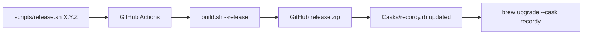

# Releasing

Releases are cut by pushing a version tag. CI does the rest.



## Cut a release

```sh
./scripts/release.sh          # list released versions
./scripts/release.sh 1.0.0    # tag v1.0.0 and push it
```

The script requires a clean `main` that matches `origin/main`.

## What CI does

The [Release workflow](../.github/workflows/release.yml) then:

1. Builds a universal (arm64 + x86_64) app with `./build.sh --release`
2. Publishes `Recordy-<version>.zip` as a GitHub release
3. Updates the version and checksum in [`Casks/recordy.rb`](../Casks/recordy.rb) on `main`

## Signed and notarized build

Run locally with a Developer ID certificate:

```sh
NOTARY_PROFILE=<profile> VERSION=1.0.0 ./build.sh --release
```
