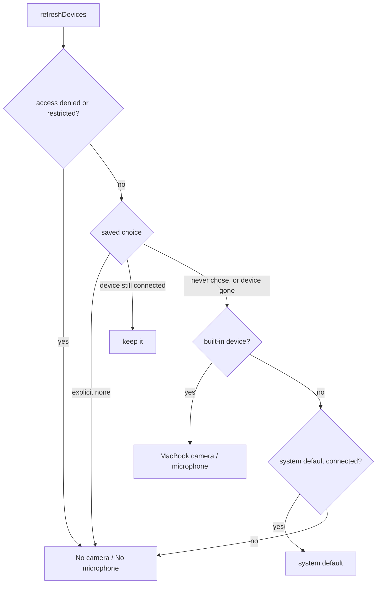

# Specs

- `selected-area.feature` describes the behaviour of issue #1 (selected area is applied automatically, and the area frame only shows on the home screen).
- `defaults.feature` describes the behaviour of issue #2 (the home screen starts with the main display in full, the MacBook microphone and the MacBook camera).

Both are written in Gherkin. Scenarios are plain English. They are not run by a Gherkin runner. Each one is mapped by hand to a Swift Testing test, a UI script check, or a manual step.

Run the unit tests with `swift test`.

## How scenarios map to verification

Unit tests, in `Tests/RecordyTests/`:
- `SelectionPickerTests.swift` drives the picker view with synthetic mouse and key events. Test display names follow "Given ..., when ..., then ...".
  - valid drag applies, exactly 64 by 64 applies, 63 by 63 stays open, thin drag stays open
  - click without drag stays open, retry after a small drag, clamping to the screen
  - resize, move, shrink below the minimum, click inside an existing selection
  - Esc (key code 53) cancels with no area, Return (36 and 76) finishes nothing, no double apply
- `RegionFrameScenarioTests.swift` and `RegionFrameTests.swift` check the pure frame rule for home, editor open or loading, countdown, recording, saving, window hidden and no area. The full truth table is in `RegionFrameTests.truthTable`.

Verified by UI script or manually (not unit-testable):
- Picker hint text: it is drawn in the view, not exposed as a value. Checked by eye in the running app. A full-screen screenshot of the picker also captures whatever is behind it, so none is kept.
- A real mouse drag closes the real picker and shows the area text on the home screen: `evidence/issue-1/drag-applied.jpg`.
- Frame hidden in the editor: `evidence/issue-1/editor.jpg` and `evidence/issue-1/frame-visibility.txt`.
- Frame hidden when the main window is closed or minimised, and back after restoring: `evidence/issue-1/frame-visibility.txt`. These need real window notifications, so they are UI-script checks only.
- Back to Recordings brings the frame back: `evidence/issue-1/frame-visibility.txt`.
- Frame while the editor is loading right after a recording stops, and during countdown, recording and saving: the rule is unit-tested, but the real flow needs a real screen recording (permissions, hardware). Manual: with "Selected area" active, record 2-3 s, stop, and confirm the white frame does not flash while the editor loads. Also confirm it is not visible during the countdown and recording.

## Evidence notes

The area frame panel has `sharingType = .none`, so `screencapture` never captures it, and the screenshots (JPEG, cropped to the app window) show the home screen text only. Frame presence is proved with the window list from `CGWindowListCopyWindowInfo`, the layer-25 400x350 entry, saved in `evidence/issue-1/frame-visibility.txt`.

No screen recording is included: the drag is covered by the screenshots and the window list. The screenshots show whatever was behind the app window on the test machine.

## Issue #2: defaults

The rules are pure functions in `Sources/Recordy/DeviceDefaults.swift`. `AppState.refreshDevices()` feeds them the saved choice (`camera` and `mic` in `UserDefaults`, missing when the user never chose), the discovered devices, the system default device and the access status.

Unit tests, in `Tests/RecordyTests/DeviceDefaultsTests.swift`. Each test display name is the matching scenario as one Given/When/Then sentence:
- MacBook microphone by default, even when an iPhone microphone is listed first
- MacBook camera by default, even when an iPhone or external camera is listed first
- system default device when there is no built-in one
- nothing selected when there is no built-in device and no usable system default
- nothing selected when no device is available
- an explicit "No camera" or "No microphone" is kept
- a device the user chose before is kept while it is connected
- the MacBook device is used when the chosen device is gone
- the system default, or nothing, when the chosen device is gone and there is no built-in one
- nothing selected when access is denied or restricted, whatever was saved
- display: the chosen display is kept, the main display replaces a missing one, then the first display, and an empty list changes nothing

Verified in the running app (not unit-testable, needs real devices and `AppState`):
- The main display is recorded in full by default, and "Record system audio" stays off: `evidence/issue-2/home-defaults.jpg` and `evidence/issue-2/defaults-check.txt`.
- With no saved `camera` and `mic`, the pickers show "FaceTime HD Camera" and "MacBook Pro Microphone", and the built-in ids are saved after launch: `evidence/issue-2/home-defaults.jpg` and `evidence/issue-2/defaults-check.txt`.
- An explicit "No camera" (`camera` saved as an empty string) is kept on relaunch: `evidence/issue-2/explicit-none.jpg` and `evidence/issue-2/defaults-check.txt`.
- `evidence/issue-2/pickers.mp4` is a short recording of the left column with the audio and camera pickers opened.

### Evidence notes

- Checked on a MacBookPro18,3 with camera and microphone access granted. The values were read with the Accessibility API, and the saved choices with `defaults read com.funivan.recordy`.
- No iPhone Continuity device was connected during the UI run, so the "built-in device is not first in the list" case is covered by unit tests only.
- The access-denied and no-device cases are unit tests only, because the access status and the hardware cannot be changed from a script.
- Screenshots and the recording are cropped to the left recorder column, so the user's own recordings are not shown.
